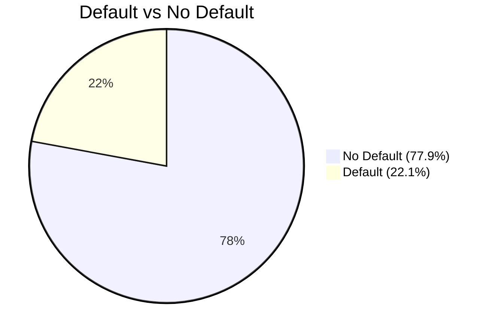
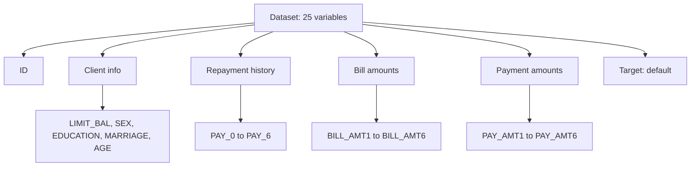
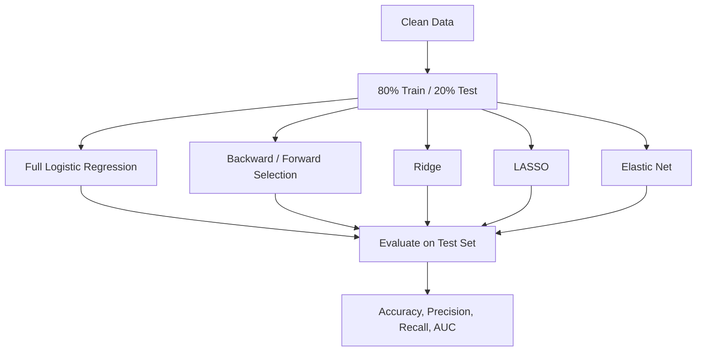

# Credit Card Default Analysis

**Module:** IT3081 – Statistical Modelling (Group Assignment)
**Tool:** R / RStudio
**Dataset:** UCI *Default of Credit Card Clients* (Taiwan, 2005)

## 1. Project Goal

A bank wants to know **which clients are likely to default on their credit card payment next month**, and which factors drive that risk.

This project acts as a statistical consultancy: explore the data, test ideas with statistics, and build models to predict default.

## 2. Files in This Repository

| File | What it is |
|---|---|
| `Default-of-Credit-Card-Clients.R` | Full R script (setup, descriptive analysis, inference, modelling) |
| `UCI_Credit_Card.csv` | Dataset: 30,000 clients, 25 variables |

## 3. Workflow


## 4. Dataset Summary

- **Rows:** 30,000 clients
- **Columns:** 25
- **Missing values:** 0
- **Duplicate rows:** 0
- **Target:** `default.payment.next.month` (1 = default, 0 = no default)



### Variable Groups



## 5. What the Script Does

### Step 1 – Setup and Data Quality
- Load packages and the CSV file
- Check structure, missing values, duplicates
- Rename the target variable and convert categories to factors

### Step 2 – Descriptive Analysis
- Group undocumented EDUCATION and MARRIAGE codes into "Unknown"
- Detect outliers (IQR method)
- Plot distributions and default rate by sex, education, marital status
- Correlation heatmap for bill and payment amounts

### Step 3 – Statistical Inference

| Test | Question |
|---|---|
| Two-proportion test | Does default rate differ by sex? |
| Welch t-test | Does credit limit differ between defaulters and non-defaulters? |
| Welch t-test | Does the latest payment amount differ between the two groups? |
| F-test and Levene's test | Does bill amount variance differ between the two groups? |
| One-way ANOVA + Tukey | Does credit limit differ by education and by marital status? |
| Chi-square test | Is default related to education level? |

### Step 4 – Predictive Modelling



## 6. Key Findings

**Descriptive and inference**
- Males default more (24.2%) than females (20.8%)
- Defaulters have a lower average credit limit (NT$130,110 vs NT$178,100)
- Defaulters pay less on average in the latest month (NT$3,397 vs NT$6,307)
- Default rate is highest for High School clients (25.2%) and lowest for Graduate School clients (19.2%)

**Modelling**
- `PAY_0` (most recent repayment status) is by far the strongest predictor
- Bill amount variables show very high multicollinearity (VIF up to about 39)
- LASSO removed `BILL_AMT4` and `BILL_AMT6`

| Model | Accuracy | Precision | Recall | AUC |
|---|---|---|---|---|
| Full Logistic | 0.814 | 0.698 | 0.239 | 0.713 |
| Backward Selection | 0.814 | 0.695 | 0.236 | 0.712 |
| Ridge | 0.811 | 0.694 | 0.213 | 0.711 |
| LASSO | 0.814 | 0.696 | 0.236 | 0.712 |
| Elastic Net | 0.813 | 0.694 | 0.233 | 0.712 |

**Main limitation:** all models have low recall (about 21–24%). They miss most real defaulters at the default 0.5 threshold, because the data is imbalanced (78% / 22%). Accuracy alone looks good but hides this.

**Possible improvements:** lower the classification threshold, use class weights, or resampling methods.

## 7. How to Run

1. Install R and RStudio
2. Put `Default-of-Credit-Card-Clients.R` and `UCI_Credit_Card.csv` in the same folder
3. Open the R file and update the file path in `read.csv(...)` if needed
4. Install packages (first time only):
   ```r
   install.packages(c("dplyr", "ggplot2", "corrplot", "car", "glmnet", "pROC"))
   ```
5. Run the script from top to bottom

## 8. Data Source

Yeh, I. C., & Lien, C. H. (2009). The comparisons of data mining techniques for the predictive accuracy of probability of default of credit card clients. *Expert Systems with Applications, 36*(2), 2473–2480.

Dataset available from the UCI Machine Learning Repository and Kaggle.
